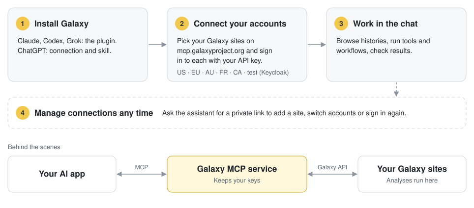

# Galaxy

Work with your Galaxy data from an AI assistant. Browse analysis histories, upload files, run bioinformatics tools and workflows, and read the results in the chat. Analyses run on the Galaxy site you choose.



## Watch the walkthrough

### Install Galaxy and run an analysis in Claude · 2:00

Add Galaxy from its GitHub marketplace, connect your Galaxy account, ask for a yeast RNA-seq comparison, follow the run, and open the results, a volcano plot and the results table in the conversation.

https://github.com/user-attachments/assets/8fda0006-99ed-46e2-a036-f4d93db6fe64

## Let an agent install it

Give this prompt to an agent with computer use, one that can operate your browser and apps (for example Claude with computer use or Claude in Chrome). Replace the target app:

```text
Install Galaxy from https://github.com/goeckslab/galaxy-plugin in <target app,
such as Claude chat, Claude Code, Codex, ChatGPT Web or Grok Build>. Follow the
repository's setup instructions for that app, using computer use to click through
its settings. Install both the Galaxy tools and the bundled galaxy-analysis skill
with all its supporting files, confirm it is available, and verify the connection
with a read-only request. When the Galaxy sign-in page opens, stop and let me sign
in, enter my API key and approve access myself; never type a key or password for me.
If my client cannot make both available, explain the limitation; do not silently
substitute tools-only access.
If you run into any problems, submit a GitHub issue at
https://github.com/goeckslab/galaxy-plugin/issues with the app/version, steps
tried, and error. Never include API keys, OAuth tokens, passwords, private
data, or chat content in the issue.
```

## What you need

- Your own Galaxy account and API key on one or more [supported sites](#connect-your-galaxy-account). An API key grants access to your Galaxy account; treat it like a password.
- One of these apps: Claude (Web, Desktop or Code) on a plan with plugins, Codex, ChatGPT Web with Developer mode, or Grok.

Galaxy has two parts: the connection supplies the tools, and the `galaxy-analysis` skill tells the assistant how to use them and check results. Claude, Codex and Grok Build install both through the plugin package. In ChatGPT Web you add them separately. There is nothing to deploy: the service is hosted at `mcp.galaxyproject.org` and analyses run on your Galaxy site.

## Install

### Claude chat — Web or Desktop

1. In the left sidebar of [claude.ai](https://claude.ai) (or Claude Desktop), click **Customize**, then **Plugins → Add → Add marketplace**.
2. Enter `goeckslab/galaxy-plugin`, select it, click **Sync**, and click **Add** next to **Galaxy**.
3. Open the installed plugin's **Connectors** tab, connect the Galaxy service, and follow [Connect your Galaxy account](#connect-your-galaxy-account).

The package includes the skill; do not upload it separately. On a Team or Enterprise plan, an owner may need to make the Galaxy connector available to the organization first.

### Claude Code

```text
/plugin marketplace add goeckslab/galaxy-plugin
/plugin install galaxy-plugin@galaxy-plugins
```

Then use `/mcp` to [authorize Galaxy](#connect-your-galaxy-account). See [Claude plugin installation](https://code.claude.com/docs/en/discover-plugins).

### Codex

```sh
codex plugin marketplace add goeckslab/galaxy-plugin
codex plugin add galaxy-plugin@galaxy-plugins
```

If Codex lists Galaxy as not logged in, run `codex mcp login galaxy`. If your version does not recognize `codex plugin add`, open `/plugins`, select **Galaxy** from **galaxy-plugins** and install it.

### ChatGPT Web

ChatGPT needs the connection and the skill added separately, and your account must offer **Developer mode** and skill upload.

1. **Connection.** In [ChatGPT](https://chatgpt.com), turn on **Settings → Security and login → Developer mode**. Open [Plugins](https://chatgpt.com/plugins), choose **Create app**, and enter:
   - **Name:** `Galaxy`, **Icon:** [`galaxy-logo.png`](plugins/galaxy-plugin/assets/galaxy-logo.png)
   - **MCP server URL:** `https://mcp.galaxyproject.org/mcp`
   - **Authentication:** `OAuth`, **Client ID:** `galaxy-chatgpt`, **Client secret:** leave empty

   Then follow [Connect your Galaxy account](#connect-your-galaxy-account).
2. **Skill.** Download this repository (**Code → Download ZIP**), compress the whole `plugins/galaxy-plugin/skills/galaxy-analysis` folder into `galaxy-analysis.zip`, and upload it under **Plugins → Skills → Upload from your computer**.
3. In a new conversation, select both **Galaxy** and **Galaxy Analysis**.

### Grok Build and Grok.com

Follow the [Grok guide](docs/grok.md).

## Connect your Galaxy account

1. Find your key on each Galaxy site you want to use: sign in, then open **User → Preferences → Manage API key** ([guide](https://training.galaxyproject.org/training-material/faqs/galaxy/preferences_admin_api_key.html)).
2. When your app starts the Galaxy connection, a page opens on `https://mcp.galaxyproject.org`. Check the address, pick your sites, and enter your own key for each one.
3. Review the access terms and approve.

Supported sites: US (`usegalaxy.org`), Europe (`usegalaxy.eu`), Australia (`usegalaxy.org.au`), France (`usegalaxy.fr`), Canada (`usegalaxy.ca`), the Galaxy test server (`test.galaxyproject.org`), and CFDE (`galaxy.cfdeworkspace.org`) for the NIH Common Fund Data Ecosystem, where you sign in through CFDE and then create an API key in Galaxy. [Request another site](https://mcp.galaxyproject.org/support#request-site).

Never paste a key into a chat, screenshot or issue. To add a site, switch accounts or disconnect later, ask the assistant; it creates a private five-minute management link. To disable a key at once, revoke it on that Galaxy site. Read the [privacy notice](https://mcp.galaxyproject.org/privacy); the service is not meant for clinical or other regulated data.

## Try it

```text
List my connected Galaxy sites and ask me which one to use. Then show my five
most recent histories there, without creating or changing anything.
```

To add data, attach a file to the chat and ask the assistant to upload it, give it a public URL, or use **Upload a file…** on the history card. In Claude, an attached file goes from Claude's code environment straight to Galaxy.

Cards for histories, reports and run status need an app that supports MCP UI; other apps show text and links. Check the source evidence: an assistant's summary is not a substitute for scientific validation.

## Troubleshooting

- **Too many approval prompts (Claude):** open **Customize → Connectors → galaxy** and set **Read-only tools** and **Interactive tools** to **Always allow**. Keep **Write/delete tools** on **Needs approval**, since they create histories, upload data and start analyses.
- **Authorization fails:** complete one login at a time. ChatGPT Web uses the `galaxy-chatgpt` client; Claude Code uses local port **3118**.
- **Duplicate tools:** keep only one Galaxy connection enabled.
- **Analysis still running:** ask for the status of the existing run instead of submitting it again.

## Support and credits

Open a [GitHub issue](https://github.com/goeckslab/galaxy-plugin/issues) for bugs, installation help or site requests. Issues are public; leave out credentials, private data and chat content. For privacy or account concerns, use the [private contact form](https://mcp.galaxyproject.org/support#private-contact).

Published by the Galaxy Project from Penn State University, Johns Hopkins University, Moffitt Cancer Center, and Cleveland Clinic; maintained by Goecks Lab. See the Galaxy logo's [attribution and usage conditions](plugins/galaxy-plugin/assets/README.md).
